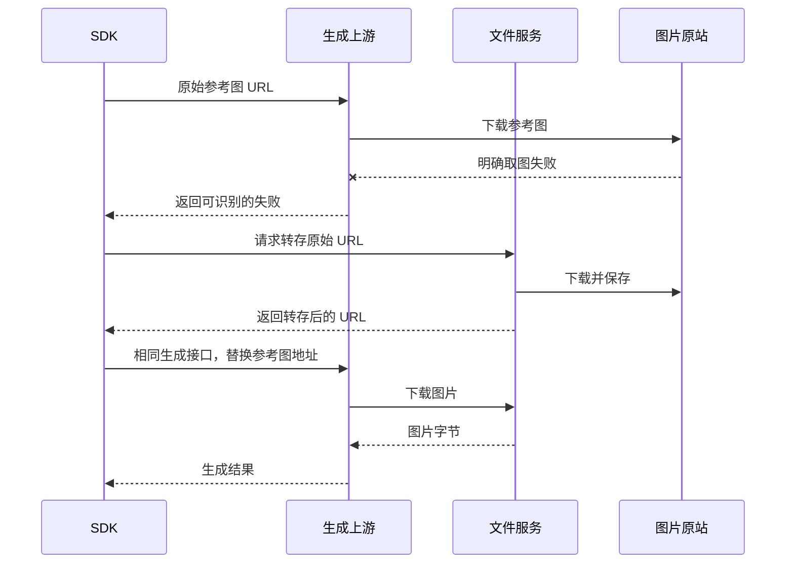

> 一句话总结：转存 URL 改变的是图片经过的链路，生成接口仍是原来的接口，取图时间仍占外层请求期限。请求变小可以算清，线路变快、生成质量与实际费用则要分别取证。

## 0. 起因：取图失败后的补救，请求反而更大了

我处理过一条图片生成恢复路径：第一次把参考图 URL 发给上游；上游明确返回取图失败后，SDK 下载图片，转成 base64，再随生成请求一起发送。

这绕过了上游访问原站的问题，却把几个短地址变成了很大的 JSON。多图时，编码膨胀还会叠加。历史样本显示大请求体与长时间超时相关，但没有单独证明瓶颈只在上传。

第一轮曾尝试压缩图片。我补做生成对照以后发现，缩体积和保留模型看到的细节是两项不同目标。后续策略改成转存参考图、继续通过 URL 交给同一个生成接口。这里更值得留下的是数据流和证据边界，不是某一组临时压缩参数。

## 1. 同一个接口，本来就可以接内容或地址

先用一个自编请求说明。接口支持两种参考图表达：

```json
{"prompt": "draw from reference", "image": "data:image/png;base64,..."}
```

```json
{"prompt": "draw from reference", "image": "https://images.example/reference.png"}
```

前者由 SDK 向生成接口上传图片内容。后者先发送地址，上游再主动向图床发起 GET，请求图片字节。图床是在响应下载请求，不是把图片主动上传到另一个隐藏的生成接口。

把参与方画出来，更容易分清谁做哪件事：



SDK 负责恢复决策，文件服务负责下载和保存。它们是不同职责。生成参数应继续沿用原请求，仅替换契约允许替换的资源引用。

## 2. 请求变小，不等于总传输量消失

Base64 每三个输入字节编码成四个字符，较大二进制内容会增加约三分之一；还要算前缀、参数及 JSON 结构。[RFC 4648 的 Base64 定义](https://datatracker.ietf.org/doc/html/rfc4648#section-4)

假设六张参考图各为 3 MiB，图片共 18 MiB，base64 部分约为 24 MiB。这是说明规律的自编算例。URL 方案中，生成请求只带几条地址；图片字节仍需经过原站、文件服务和上游，整体传输量未必减少。

确定改变的是：大图片不再作为生成接口请求体的一部分上传。可能改善的是：图片由另一处存储或 CDN（内容分发网络）提供，上游访问这条路径的实际表现可能不同。

若两条路径都慢，改成 URL 仍会超时。原图失效、需要登录或拒绝文件服务访问时，转存也救不了。把「换一条有机会成功的路径」说成「换成图床就不会失败」，证据就越界了。

## 3. 外层期限不会因为多一次下载而暂停

我一开始讲数据流时，漏讲了外层时钟。读者自然会问：图片还是要传，下载也可能慢，这到底省了什么？

外层生成请求从开始到结束有自己的期限。上游收到 URL 后下载参考图、处理图片、执行生成，都发生在这段等待期间。图床下载还可能受上游自己的期限约束，两者不能混成同一个数字。

Go 的 `http.Client.Timeout` 包含连接、重定向和读取响应体，返回响应头后计时也不会自动停止。[Go Client 文档](https://pkg.go.dev/net/http#Client)

因此应比较两条路径各阶段的耗时，而不是比较配置里的超时常量。没有改变超时，不代表没有优化；改了超时，也不能证明传输更快。

## 4. 看速度，要测真实两端

我后来核参数时，把观测项分成下面几类：

| 指标 | 回答的问题 | 常见误判 |
|---|---|---|
| 实际请求体和图片字节量 | 到底传了多少 | 把图片大小当最终 JSON 大小 |
| 连接、请求写完、首字节、读完时间 | 时间耗在哪个阶段 | 只看总耗时就说上传慢 |
| 吞吐、往返延迟、丢包与重传 | 真实线路表现怎样 | 用本机下载推断上游下载 |
| 缓存命中和实际服务节点 | 是否从缓存提供图片 | 一处命中就推断所有地区命中 |
| 多图下载方式和内部期限 | 下载是否串行、何时失败 | 把未知内部配置当已有事实 |

历史本机下载曾命中缓存，但这只能证明当时那个客户端、那个节点的响应。刚转存的新 URL 可能遇到冷缓存，上游访问的又可能是另一地区节点。缺真实两端计时，就不能给出确定提速比例。

连接池里的空闲连接数也不是并发上限；缓存保留时间也不是下载超时。这些参数名称接近，职责却不同，应该顺着实际配置使用点解释。

观测还不能直接决定是否可重发。Go 的 HTTP trace 回调可能并发执行，也可能晚于请求结束或失败；没有观察到写完回调，不足以证明上游没有收到完整请求。[Go ClientTrace 文档](https://pkg.go.dev/net/http/httptrace#ClientTrace)

## 5. 明确失败和结果未知，要走不同恢复路径

上游明确说参考图获取失败，和本地等不到最终回答，是两种状态。

前者有具体可恢复原因。后者可能已经完成生成，只是结果没有送回来。贸然重新生成，可能产生第二次执行和第二次上游费用。

我现在会为恢复状态写一张表：

| 状态 | 恢复原则 |
|---|---|
| 明确取图失败，参考图在外站 | 按策略转存后重试 |
| 明确取图失败，已经是受控图床 | 按有限次数重试 |
| 转存失败 | 停止这条恢复路径，按任务政策收尾 |
| 生成请求结果未知 | 保留未知语义，不把它改成可重新生成 |

重试次数和总时间预算应在整个任务内共享。每次换一种恢复方式都重置预算，会把一次有限尝试变成多层放大。多图转存还应保持顺序，必须的图片都准备好以后再发生成请求，不能悄悄少图。

## 6. 字节保真、生成质量与收费是三份证据

「SDK 不再压缩」只能说明 SDK 没主动改图，不能单独证明文件服务原样保存。

我保存过固定 JPEG 和透明 PNG 的转存对照：下载转存对象后的字节数与哈希一致。它支持这两份固定素材在当次路径中的字节保真。动态 URL 的对照却不同，仍缺文件服务那次从原站实际收到的字节，无法区分源站变化和服务内部处理。

完整比较至少有三个位置：

```text
原站该次响应 → 文件服务该次收到的字节 → 存储后下载的字节
```

如果只在两台客户端分别访问动态 URL，得到不同内容并不意外。即使 URL 相同，也不能假定图片相同。固定版本素材或保存真实下载样本，才能缩小因果范围。

生成质量还要另测。原图、处理后的参考图和最终成片是三层对象；文件哈希一致不能证明模型对所有素材都产生相同效果。随机生成的小样本未测出差异，也不能推出两种策略等价。

收费再拆成文件配额、平台任务结算和上游执行账单。转存不占文件配额，不代表上游失败尝试免费；平台失败退款，也不能反推上游没有收钱。

## 7. 可直接复用的验证清单

1. 画清每次 HTTP 交互的发起方、响应方和传输内容。
2. 核最终请求字节，区分内容内嵌与 URL 引用。
3. 用明确失败、转存失败、受控图床失败、结果未知各测一条路径。
4. 多图检查数量、顺序和未变的生成参数。
5. 用固定字节素材核哈希，再用实际生成对照判断质量。
6. 分开核文件配额、任务账本和上游费用。
7. 上线收益使用真实命中恢复路径的样本，不能只统计所有成功单。

## 收尾

1. **接口没换，传输职责变了** —— URL 由上游主动下载，文件服务负责提供图片。
2. **外层时间照常计** —— 图片下载仍占生成请求的总等待。
3. **字节收益与线路收益分开** —— 前者可算，后者要测真实端点。
4. **未知结果保留未知** —— 没等到回答不等于没有执行。
5. **证据逐层成立** —— 原样转存、生成效果和实际费用各有观察点。

下次解释这类方案，我会先讲清「谁向谁请求什么」，再讨论性能。否则同一张图虽然画对了，读者仍可能以为多了一个接口，或多得了一段时间。结果交付后的恢复见[结果保留到确认完成](/blog/model-onboarding/result-retention-until-ack/)。
