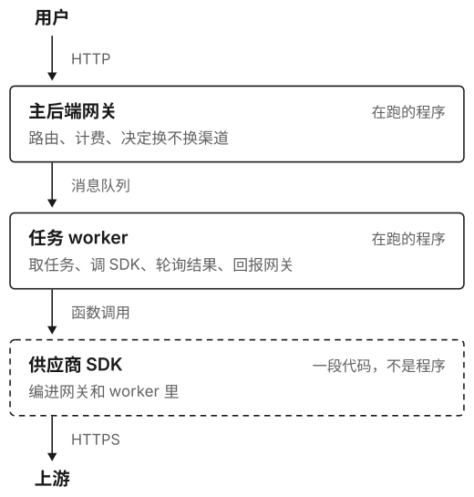

> 一句话总结：失败后能不能把同一个请求再发一次，取决于两件事：这次失败时上游收没收钱，我们知不知道。答案由请求走到了哪一步决定（没发出去、发了没回、回了什么），不由错误文本里有哪些词决定。套一个现成的通用判定之前，先把真实的错误串一条条喂给它；同一渠道不再发，也不等于上层不会换渠道再做一次。

## 0. 起因：一条「加一行就行」的修法

leader 开了一个 issue：某云厂商的图像生成模型走同步接口，请求发出去之后如果连接断开或读超时，供应商 SDK 会把同一个出图请求原样再发，最多 3 次。上游可能第一次就已经出图并计费，平台却只向用户收一份钱。

issue 里附了建议的修法。SDK 里有一个现成的通用判定，输入一个错误，回答「能不能安全重发」；在重试循环前加一行，判定不通过就直接返回。issue 还写明，上游的限流和临时不可用是带状态码的明确应答，这个判定会放行，限流重试不受影响。

我把任务交给助手，最后没有照这一行改：把判定换上去跑同一套测试，有 14 项变红。这篇讲三件事：现成的判定为什么不能直接套，最后按什么裁决，以及我在这个任务里才补上的一张图。修复提交之后，我才反过来问助手「SDK 到底是什么」「几层重试怎么不叠加」。也就是说，我是在没有图的情况下批的方案，所以先从图讲起。

同一个问题我两周前就碰过一次，是一个视频生成模型的异步建单。worker 调 SDK 向上游发建单请求，等响应超时后，SDK 当成普通失败又发了一次。上游可能两单都接了，平台只记住第二单的任务号，第一单成了没人管、却可能计费的孤儿任务。那次的教训散在后面几节里：判断表多了「响应体」一维（第 4 节），整条链上还有别的重发来源（第 5 节），关停时的回收入口（第 6 节），以及线上生效要分几层证据（第 7 节）。

## 1. 先有一张图：一单请求经过哪几层



四件事要记住。

1. 线上在跑的只有网关和 worker。供应商 SDK 是一个代码库，没有可以单独运行的入口，不部署，也没有端口。说「SDK 报错」，实际是 worker 或网关进程里那段 SDK 代码报错。
2. 网关和 worker 各带一份 SDK。任务有两种走法：交给 worker 执行，或者网关在自己进程里直接调。两边都要用同一套对接上游的代码，它只能做成两边都能引用的库。
3. 「带的是哪一版」写在下游自己的依赖文件里，第 7 节细说。
4. 一次失败会经过两层「要不要再来一次」。SDK 决定在同一个渠道要不要再发；任务失败回到网关后，网关决定要不要换一个渠道再做。在这条出图链路上，worker 自己不重发，只建一次单，然后查到任务时限为止。

没有一个统一的「总共最多几次」的计数器。最坏情况是相乘：SDK 的重发次数乘以网关换的渠道数。只有每一次失败都确定没被收钱，这个乘法才不花钱。这次的 issue，就是这个前提在 SDK 这一层没守住。

## 2. 判断只有一个：上游收没收钱，我们知不知道

这家上游的计费规则有公开文档：只对成功返回（HTTP 200）的请求收费，4xx 和 5xx 不收（文档）。有了这条规则，一次请求按走到哪一步分三种：


规则只有一句：**只有确定没被收钱，才在同一渠道再发**。能确定的只有 ①，和 ③ 里「上游明确拒绝」那一种。

动手前我问过助手：根因是不是重试范围太广，请求发多了导致多扣费？这句话对了一半。改前的写法是黑名单，除了鉴权失败和几种参数错误，其余一律再发，范围确实太宽。但多付不是因为「请求多」。上游明确回 429、500、503 时，再发多少次都不花钱，这部分重试要留着，它还能提高成功率。多付只出在一种时候：这一单上游可能已经做了，或者已经回了 200，我们又发了一次。

所以根因要说成：重发之前没有按「收没收钱、知不知道」来分。只说「范围太广」，推出来的修法就是「少重试」，那正是 issue 那一行会出问题的地方。

## 3. 现成的判定不能直接套：把真实的错误串喂给它

那个通用判定拿到的只有一段错误文本。它从文本里找线索：能确认请求没发出去，或者抽得出 429、5xx 这样的状态码，就判可以再发，其余不再发。

问题在「从文本里猜」。助手把改前代码里真实会出现的错误串逐条喂给它（实测；下表的错误文本是我改写过的示意）：

| 失败 | 错误文本长什么样 | 它怎么判 | 照 issue 改的结果 | 应该 |
|---|---|---|---|---|
| 上游明确限流 | `provider error (429 RATE_LIMITED): …` | 不再发：状态码前没有它认识的前缀，抽不出来 | 第一次 429 就停，限流重试被关掉 | 再发，不收费 |
| 上游明确回 500 / 503 | `provider error (503 UNAVAILABLE)` | 不再发，原因同上 | 丢掉免费的重试 | 再发 |
| 代理回的 502 页 | `upstream error (status 502): <html>…` | 可以再发：抽得出 502 | 照旧发 3 次 | 不再发，不知道是谁回的 |
| 取凭证、下载输入图时断开 | 文本里也有 EOF、timeout | 不再发 | 丢掉安全的重试，这时生成请求还没发 | 再发 |
| 回 200 后读响应体中断 | `decode response: unexpected end of JSON input` | 不再发，判对了 | 不再发；但交给网关的只有这一句，网关认不出这单已经计费 | 不再发，并带业务码 |

前四行是判错。第五行是判对了，但交给上层的信号不够，第 5 节再讲。issue 里「限流会被放行」那句，和实测不符。

这不是那个判定写得差。它是为另一批调用点写的，那些调用点的错误文本带着它认识的前缀。换一个调用点，文本格式不同，同一个 429 就抽不出来。

异步建单那次碰到的是反面。传输层的错误是一段文字，代理层报错时，文字里可能带着「504」。助手修复的初稿用了一个现成的辅助函数，从错误文本里解析出状态码，再查通用的状态码表决定能不能重试。可错误文字里出现 504，不等于真的收到了一个 504 响应：前者没有任何上游回话可依据，后者至少是有人明确回了话。把前者送进通用码表，「结果不明」就被覆盖成「暂时失败」，又触发一次重发。反过来也一样：一个真实的 401 响应，正文里恰好有「连接被拒」之类的字样，也不能因此改判成网络错误。这次是另一面：真的收到了 429，文字的写法不对，判定也认不出来。

把通用判定套进旧的重试循环之前，先做一件事：从每个出口抓真实的错误串，写成表驱动测试，一条条看它怎么判。

```go
func TestPredicateOnRealErrorStrings(t *testing.T) {
	cases := []struct {
		name string
		text string // 从真实出口抓下来的错误串，不是手写的理想格式
		want bool
	}{
		{"上游明确限流", "provider error (429 RATE_LIMITED): quota exceeded", true},
		{"代理回的 502 页", "upstream error (status 502): <html>Bad Gateway</html>", false},
		{"回 200 后读体中断", "decode response: unexpected end of JSON input", false},
	}
	for _, c := range cases {
		if got := canResend(errors.New(c.text)); got != c.want {
			t.Errorf("%s: canResend=%v, want %v", c.name, got, c.want)
		}
	}
}
```

## 4. 改法：在发请求的地方按阶段给结论

最后的做法是不再从文本里猜。走到了第几步，发请求的那几行代码最清楚，就在那里直接给出「能不能再发」，重试循环只认这个结论。

```go
type Stage int

const (
	BeforeSend Stage = iota // 生成请求还没发：取凭证、下载输入图
	NoReply                 // 发出去了，没等到状态码
	GotStatus               // 收到了状态码
)

type AttemptError struct {
	Stage    Stage
	Status   int    // 只有 GotStatus 才填
	Explicit bool   // 响应体是上游自己的错误结构，不是一页 HTML
	Code     string // 交给上层的业务码，例如「后处理失败」
	Err      error  // 错误原文不动，上层的规则还靠它认失败
}

func resendOK(e *AttemptError) bool {
	switch e.Stage {
	case BeforeSend:
		return true // 上游没收到，确定没收钱
	case NoReply:
		return false // 不知道上游做没做
	}
	if e.Status == 200 {
		return false // 已经计费，之后读响应体、转存失败都不能再发
	}
	if !e.Explicit {
		return false // 中间某台机器回的，不知道上游收到没有
	}
	return e.Status == 429 || e.Status == 500 || e.Status == 503
}
```

错误文本一个字没改。网关的分类规则靠这些文本认失败（见[错误分类、重试和渠道禁用](/blog/model-onboarding/error-classifier-channel-disable/)），改措辞等于改另一个仓的行为。

异步建单那次用的是同一个思路，结论多一种「已接单」：收到真实响应、拿到了任务号。leader 在我那次的修复上又改了一轮，其中一处补的是我漏掉的一格。真实收到了一个非 2xx 响应，随后读响应体时连接断开，或者响应体超过大小上限。我的实现先看到「响应体读坏了」，就整体判成结果不明，把已经拿到的 401、429、503 裁决全抹掉了。修之前，两个建单入口各 3 个状态、共 6 条用例在这里失败。

HTTP 状态和响应体是否完好是两个维度，不能互相覆盖。审建单重试时，我先把下面这张表填满，每一格对应一条测试，同时断言上游实收几次和上层拿到的错误类型：

| 送达情况 | 真实 HTTP 状态 | 响应体 | 判定 | 自动重发 |
|---|---|---|---|---|
| 连接没建立、请求没写完 | 无 | 无 | 确认未送达 | 可以，有上限 |
| 请求已写出，等响应超时 | 无 | 无 | 结果不明 | 不重发 |
| 传输错误，文字里含「504」 | 无 | 无 | 结果不明 | 不重发 |
| 收到响应 | 2xx | 完好，有任务号 | 已接单 | 不需要 |
| 收到响应 | 2xx | 读坏或没有任务号 | 结果不明 | 不重发 |
| 收到响应 | 504 | 任意 | 结果不明 | 不重发 |
| 收到响应 | 401 / 403 | 完好或读坏 | 明确拒绝 | 不重发 |
| 收到响应 | 429 | 完好或读坏 | 明确拒绝，可退避 | 按限流策略 |
| 收到响应 | 其他 5xx | 完好或读坏 | 按产品策略 | 按策略，计入总预算 |
| 收到响应 | 4xx 参数类 | 正文含「连接被拒」字样 | 仍按状态码判 | 不重发 |

「其他 5xx」那一行是 leader 的取舍：504 仍按结果不明停发，其余 5xx 在同一个建单时间预算内有限重试，用一定的重复风险换回一部分本来能成功的请求。它不说明 5xx 天然代表上游没接单。出图这条链路多一层判断：5xx 还要看响应体是不是上游自己的错误结构，也就是上面代码里的 `Explicit`，理由在第 5 节。leader 那一轮还把单次请求的时限和整条建单链的总预算拆成了两个守卫。

读坏响应体的那个错误只进日志，不往下游传。否则下游拿到一段含「超时」「断开」的文字，可能再一次把已有裁决改判成未知。

还有一个阴性结果骗过了我们一次。原测试里，超长响应体的夹具是一串纯字符，本身不是合法 JSON，测试只断言「结果不明」。即便把大小守卫删掉，解析失败照样会判成结果不明，测试照样绿。独立复核改用一段合法 JSON，在尾部补空格：恰好等于上限时返回同一个任务号，多 1 字节时准确返回大小错误。边界测试只改变一个因素：合法的那一侧和超限的那一侧，除了长度什么都不变。

验证用同一个探针：本地假上游按剧本回各种失败，数它实际收到几次请求，改前、改后的代码各跑一遍（实测，没有真实上游调用）。

| 失败 | 改前上游收到 | 改后上游收到 |
|---|---|---|
| 连接断开、读超时 | 3 次 | 1 次，任务失败 |
| 回 200 后响应体读到一半断开 | 3 次 | 1 次，并带「后处理失败」业务码 |
| 上游明确回 429 / 500 / 503 | 3 次 | 3 次，不变 |
| 上游回 504，或不带上游错误体的 5xx | 3 次 | 1 次 |
| 429 三次都限流 | 任务挂在「处理中」直到超时 | 几秒后判失败 |

光测「返回了错误」不够，关键是两个断言：上游实收几次，上层拿到的错误是什么类型。异步建单那次，我还做了一次最小变异：只把那一行从文本解析状态码的分类恢复回去，目标用例实收 3 次 POST，在次数断言上失败。这样才能说明守卫挡住的就是重复建单，不是碰巧被别的报错或提前返回挡住。

有两行要解释。

504 按文档不收费，也不再发，理由是时间。单次请求最长能等好几分钟，再发一次就会越过任务的总时限：任务已经超时退款了，SDK 还在替它发请求。

最后一行是顺带查出来的另一个问题。限流重试用完后，SDK 把任务标成「重试中」，等一个旧队列来接手换渠道。那个队列在半年前的重构里删掉了，再没人改这个状态，任务就一直挂到超时。它不在 issue 范围内。我问助手：只保留限流重试，侵入是不是更小，能不能解决问题？回答是能解决 issue，解决不了这个挂起。我定了一起修，条件有两个：报告里讲清哪些是 issue 之外的；放进单独的提交，leader 不同意可以单独回退。

## 5. 同一渠道不再发，不等于网关不换渠道

SDK 这层堵住之后，还剩一层。

我们和上游之间隔着别的机器：上游自己的前端、中转、CDN（内容分发网络）。它们扛不住或等超时了，会自己回一个 502、503 或 504，响应体是一页 HTML，不是上游那种带错误码和说明的结构。看到这种响应，只知道中间有台机器说不行，不知道上游收到请求没有、是不是还在出图。

改后 SDK 把它判成结果不确定，同一渠道不再发。但 SDK 交给网关的只有错误原文，里面没有「结果不确定」的标志，也没带业务码。网关按默认规则，把带 502、503 的文本归成服务端错误，算渠道故障。这个模型的渠道故障如果配了换渠道，网关就去另一个渠道再出一次图。第一个渠道那边上游可能其实出了图、收了钱，第二个渠道又收一次。

这是分层的代价。库清楚这次失败走到了哪一步，但信息过进程边界时，只剩一段文本和一个业务码，没带上的上层就不知道。「回 200 后读体中断」那一行能堵住，是因为有一个现成的业务码可以带。「代理回的 5xx」没有合适的现成信号，要新加一个业务码，SDK 发、网关认，两个仓一起改。它在改前就是这样，不是这次引入的。我把它列成请 leader 定的事，建议另开 issue。

所以说「不重试了」，要说清是哪一层。线上给这些模型配了什么换渠道规则，我看不到，报告里这一段只写到「按代码默认规则推」。

异步建单那条链更长，重复付费的来源也更多。SDK 把结果不明的建单限制成只发一次，只是其中一层：

- worker 拿到结果不明后，怎么向网关报终态；
- 网关收到「结果不明」，会不会把任务改投给别的渠道再建一次；
- 任务租约在长等待里有没有正常续上，过期后会不会被别人接手重跑；
- 下游有没有真的用上新版 SDK（第 7 节）。

所以 SDK 的测试全绿，推不出「线上重复付费已经清零」。那次我在本地按生产同款的派发路径起了全栈（搭法见[异步任务链路：从建任务到结算](/blog/model-onboarding/async-task-local-full-stack/)），用真实 SDK 加假上游跑了三条：EOF 和 504 各只发一次建单，没有切到备用渠道，失败后全额退款；正常那条只扣一次，冻结额归零，队列里没有残留。这仍是本地模拟，不替代生产账单。

全栈首轮还出过一次夹具错误。助手照着 SDK 里的字段写请求，把上游的分辨率字段当成了平台对外的画质参数。平台不认这个字段，按默认画质计价，和独立算出的价格预期对不上。修法是改输入，走真实的公开参数，不是改预期去迁就结果。验收任务型接口时，输入要从用户真正会用的公开入口进。

## 6. SDK 开始响应取消：回收入口也要跟上

异步建单那次，leader 的改动里还有一处在 worker。新版 SDK 开始认真响应 context 取消，这本来是好事，却让 worker 一个早就存在的问题露了出来。

**现象**：worker 有两个入口会调建单。一个是正常消费，另一个是回收入口：进程重启后，把上一轮没确认完的消息捞回来继续处理。回收入口把「接收消息」的 context 直接传给了建单，而且没有登记进等待组。滚动重启时，接收 context 一取消，正在进行的建单立刻被打断；进程退出时也不会等它。

**根因**：旧 SDK 不怎么理会取消，问题被盖住了；新 SDK 一认真，问题就显露出来。

**修复**：建单用一个独立的工作 context，和接收消息的 context 分开；每个在途任务都登记进等待组。关停时先停止接收，给在途任务一段宽限期自然收尾；宽限耗尽才取消，并且把任务报成终态、确认消息，不留在半路。

```go
func (w *Worker) handle(msg Message) {
	w.wg.Add(1) // ← 回收入口原来漏了这一步
	go func() {
		defer w.wg.Done()
		// 工作 context 独立于接收 context：停止接收不打断在途建单
		res := w.sdk.Create(w.workCtx, msg.Task)
		w.reportAndAck(msg, res)
	}()
}

func (w *Worker) Shutdown(grace time.Duration) {
	w.stopIntake() // 先停接收，不再领新消息
	done := make(chan struct{})
	go func() { w.wg.Wait(); close(done) }()
	select {
	case <-done:
	case <-time.After(grace):
		w.cancelWork() // 宽限耗尽才取消，被取消的任务报终态并确认
		<-done
	}
}
```

`wg.Add` 和关停之间要有锁序保证，否则关停开始后仍可能有新任务登记进来。另一个容易混的点：关停的宽限期通常只有几十秒，SDK 的建单预算可能长达几分钟。宽限耗尽时被取消的建单，按第 4 节的判断表多半落进「结果不明」，要有终态出口。

回归时旧版上两个目标用例变红，修后带竞态检测的用例全绿，覆盖了宽限耗尽时的终态和消息确认。给 SDK 加取消响应时，要把正常消费和回收两个入口的生命周期一起追一遍。

## 7. 修在库里：合并了不等于线上变了

修复在 SDK 仓。我问助手：worker 和网关都依赖 SDK，为什么 SDK 合并后不生效，是 SDK 里规定了它们的版本号吗？

方向反了。不是库规定下游，是下游各自写明「我用库的哪一个提交」。库不知道谁在用它。

- worker 和网关的 `go.mod` 里各有一行，写着 SDK 的模块路径和一个伪版本号，末尾 12 位是 SDK 的某个提交。这一行就是常说的「钉」。
- 线上跑的是 worker 和网关的可执行文件。构建时 SDK 的源码被拷进各自的 `vendor/` 目录，再一起编进去。
- SDK 仓合并，只是 SDK 主干多了新提交。下游那一行没改，重新构建多少次，编进去的还是旧代码。

要生效得走三步：两个下游各自把钉的提交改成新的，重新 vendor 并构建，再部署。打个比方，SDK 是一本菜谱，worker 和网关各自复印了某一版贴在厨房。菜谱出了新版，墙上的复印件不会自己变。写着「我用第几版」的是厨房，不是菜谱。

本地有个例外容易混。开发机的 `go.mod` 里常有一行 `replace`，指向旁边目录里检出的 SDK。本地编译用的是那个目录当前的代码，不看钉的版本。所以「本地测过」证明不了「线上钉的那一版里有这段代码」。

反过来也会误判。异步建单那次，助手看到下游依赖文件里的 SDK 版本号还是旧的，就把它叫成「发版缺口」，我第一反应是担心 leader 的合并顺序弄错了。实际上同一个文件里还有一条替换指令，打进 vendor 的代码可能已经是新的。旧版本号最多说明依赖记录没同步，推不出线上没修好，也推不出合并顺序有错。

那次之后，我判断「某个修复上线了没有」固定按四层问，每层只接受它能证明的结论：

| 层 | 问什么 | 能证明 | 证明不了 |
|---|---|---|---|
| 源码 | 修复提交合进主干了吗 | 代码存在 | 有没有被构建 |
| 依赖与 vendor | 下游实际装的是哪份 SDK 代码 | 构建输入 | 构建有没有发生 |
| 制品与实例 | 运行中的镜像由哪次构建产出，所有目标实例都切换了吗 | 线上跑的是什么 | 目标行为有没有触发 |
| 行为 | 目标场景实际发生过、表现符合预期吗 | 修复生效 | — |

线上一笔正常成功的单子，证明不了「修好了」。这类修复只在超时、断开、关停回收时才起作用，正常单子走不到那条分支，修前修后表现一样。为了取证再额外花钱下单，也换不来这层证据。我这边看不到部署信息，制品与实例这一层只能请 leader 或负责发布的同事确认。缺运行证据时，要在开工时就说清缺哪份证明、谁能提供，不要收尾时才说「线上未知」。这只针对「某个特定修复是否已生效」；普通的功能、计费回归，用普通账号从用户侧核就够了。

这是我第三次碰到「钉」，前两次都问过，这次还把方向说反了。四层证据的表是上一次列的，这次补的是它的前提：先分清哪个是在跑的程序，哪个是被编进去的代码。给 leader 的话里我加了一句：合并后还要两个下游升级钉的版本才生效。

## 8. 两个顺带的教训

**「查不到」可以再逼三条路**。助手的第一版分析里，把「上游对 500、504 收不收费」写成没查到，列进了要 leader 定的事。我回了三个问题：再查查？能不能做实验测出来？同类功能在代码里是怎么处理的？几分钟后它找到了两份官方计费文档的原文；给了一个花费很小的实验方案（我手里没有可用的 key，定了不测，以文档为准）；还把代码里几个同类模型的重发判法列成了表。结论因此改了两处：那条待定不用 leader 定了；issue 说的「同一单多付几倍」要重新划范围，一定多付的只有「回 200 后读体中断」。

**旁路提问里的回答，用之前贴回主对话核一遍**。Claude Code 有一个不打断主任务的旁路提问（`/btw`）。我在那里要了一张「issue 改法的数据流」表，觉得讲得好，贴回主对话，让助手放进报告。助手对着实测输出一核，发现表里有一行写错了：它写的是「回 200 后读体中断会被判成可以重发」，实测是判不重发，真正的问题在交给网关的信号上。旁路提问的回答不进会话记录（实测，本机只留下我的提问），事后没法回头查。它适合当场弄懂一件事；要放进给别人的东西，先让助手对着实测或代码再核一次。

## 收尾

审一处「失败后重试」，我现在按这个顺序问：

1. **先问钱** —— 这次失败时上游收没收钱？我们知不知道？收费规则写在哪份文档里？
2. **按阶段分** —— 没发出去、发了没回、回了什么，在发请求的地方给结论，不从错误文本里猜。
3. **喂真实错误串** —— 套现成判定之前，从每个出口抓真实文本逐条测；判对了，还要看交给上层的信号够不够。
4. **状态和响应体分开判** —— 已经拿到的状态码裁决，不因为之后读响应体出错而被抹成结果不明；判断表逐格测。
5. **数上游收到几次** —— 验证看假上游实收的请求数，改前、改后各跑一遍，再做一次最小变异。
6. **说清哪一层** —— 同渠道再发、换渠道、租约过期重跑是不同的层，条件和配置的位置都不一样。
7. **两个入口一起追** —— SDK 开始响应取消时，正常消费和回收入口都用独立的工作 context，并登记进等待组。
8. **合并不等于上线** —— 改的是库，就写明下游钉的是哪一版、谁来升；源码、依赖、制品、行为各证一层。

这次最该记住的不是那张阶段表，是顺序。我在修复提交之后才问「SDK 是什么」，方案能批下来，靠的是助手的分析和测试，不是我的判断。下次接到问题，我先在第 1 节那张图上指出它出在哪一层，再看修法。没照 leader 建议做的报告该怎么写，见[给 leader 的报告](/blog/methods/report-for-leader/)第 9 节。任务拿到结果之后、回报网关那一跳的问题，见[结果已经存好：为何回报失败仍会丢掉任务](/blog/model-onboarding/result-retention-until-ack/)。
