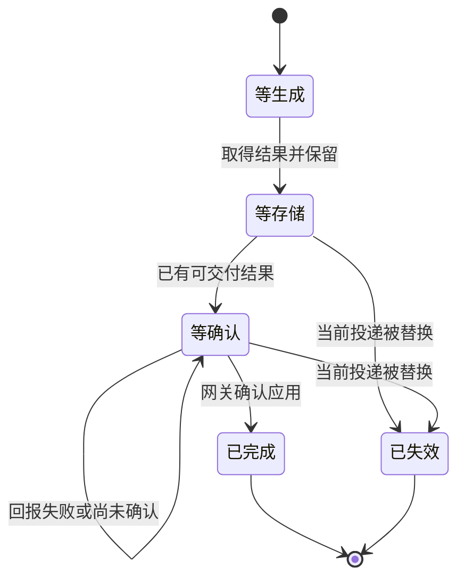

> 一句话总结：结果存好之后，任务还可能停在「网关没确认」这一层。发送端要保留已经取得的结果，按确认状态继续回报；截止时间、退避和清理身份都要围绕这次投递设计，才能避免把已完成的生成误判成超时，或删掉新一轮仍在使用的上下文。

## 0. 起因：成功结果卡在最后一跳

我回看一组异步任务的修复记录时，遇到一个很容易漏掉的组合：上游已经完成，文件服务也已存好，worker 向网关回报完成时却恰好失败。下一轮再执行，任务走进了普通超时路径。

单看每个组件，似乎都有合理解释。上游确实成功；文件服务确实返回了存储地址；网关没有收到完成状态，只能继续按在途任务处理。问题藏在发送端：它只为「还没存完」的结果登记保留状态，存得太快的结果反而没有留下。

这篇根据那几天连续的代码修订和相邻测试整理。我核对的是修复与断言的对应关系，没有在整理文章时重跑原业务栈，也不把仓库里其他人的提交说成自己的实现。

之前的[异步任务本地全栈](/blog/model-onboarding/async-task-local-full-stack/)讨论过转存这一跳怎么测通。这次关注的是转存之后：一个结果从「我拿到了」到「对方确认了」，中间还要维护什么状态。

## 1. 三次完成：生成、存储和应用回报

这条链路至少有三个不同的完成点。生成完成，意味着已有原始结果；存储完成，意味着已有可交付的文件或受控的回退地址；网关应用回报，才意味着任务状态按这次结果推进。

第三步也不能只看 HTTP 请求没有报错。接收端可能判断这条回报已经过期，或者任务已被重新分配。发送端要按双方约定识别「已应用」「重复但已处理」「当前投递已失效」和「尚未确认」。

我把相关状态画成下面的简化图。它用于解释职责，不对应原项目的字段名。



关键变化是登记顺序：拿到结果时先把它纳入保留状态，再尝试存储和回报。这样，即使存储第一次查询就完成，回报失败后也有同一份结果可用，不需要重新依赖上游还能否查到它。

最初这组修订的保留状态只是进程内机制，修正了正常运行期间的状态推进，没有自动提供进程崩溃后的恢复能力。后续关停交接又补上了持久记录、接管和幂等应用，边界见本文第 7 节；两个阶段的证据不能混用。

## 2. 回报失败后：重报已有结果，避免退回生成阶段

历史测试专门制造了第一次完成回报失败，随后再次执行轮询。断言要求保留状态仍在、第二次带着同一份已存储地址回报、期间没有报失败。上游桩只准备了一份成功结果，避免代码靠再次查询偷偷绕过问题。

这个测试的价值在于把两类失败拆开：还没拿到生成结果时，上游查询异常需要继续查询；已经拿到结果后，网关回报异常需要继续回报。两者依赖的系统不同，也不应共用完全相同的截止判断。

普通生成超时守卫如果不认识「已有结果，等待确认」，就会在下一轮把成功结果判成失败。反过来，若所有任务都无条件跳过超时，又会让真正没生成结果的任务无限等待。保护必须只作用于明确持有结果的那一类状态。

接收端也要能识别重复回报。网络失败可能发生在状态已经写入、响应尚未送回之后。发送端无法靠超时判断对方一定没处理，因此重报需要稳定的投递身份，重复到达不能重复结算。这是检查回报契约时必须核对的一项，不能由发送端单方面保证。

## 3. 两种等待：等文件和等确认各有预算

结果转存不能一直等。存储耗时太长时，系统可能需要先交付受控的回退地址；等网关确认则是在交付既有结果。两个等待阶段混成同一个 timeout，很容易把「停止等更好的地址」误写成「放弃这个任务」。

修订中有一个更早的边界：worker 不能每次恢复轮询都从当前时间重新获得一整段等待。任务此前已经排过队、执行过，网关按任务创建时刻计算的截止时间并没有随之延后。

因此，要把可用预算传到真正发起存储等待的一层。外层轮询知道只剩一小段时间，内层客户端却仍按完整默认时长等待，这个外层限制就没有实际作用。循环下一次唤醒的时刻，也要和剩余预算一起调整。

临近截止时还存在相反的问题：等待缩得太短，文件服务连回退地址都来不及回答，worker 就交出了原始地址。历史修订为取得一次答复保留了短等待，并依赖网关接管前的余量。这种余量是部署契约的一部分；网关配置变化后，需要一起核对，不能把某个固定秒数当成普遍保证。

## 4. 持续重报：避免空转，也别意外改变关闭时的行为

保留结果之后，还要决定重报节奏。网关暂时不可用时，所有已完成任务若持续高频回报，会制造额外压力。后续提交增加了逐步拉长、带上限的重报间隔。

这个间隔上限控制的是请求频率，不是总生命周期。历史实现选择继续保留并重报，没有仅凭重试次数耗尽就丢弃结果。这样的选择需要配套观察待确认数量、最老等待时间和失败原因；仅有一条「重试中」日志，很难判断积压是否还在增长。

另一个修订限制了开关范围。新增保留行为原本连功能关闭时也生效，导致关闭后的超时表现仍与旧版本不同。后续把保留逻辑约束到启用路径，关闭时恢复原有查询和超时行为。

因此，功能开关的验收也要覆盖失败场景。只测「关闭时正常请求成功」，无法证明发生网关故障时真的回到了原来的处理方式。

## 5. 清理登记：任务相同，投递可能已经不同

结果处理需要登记任务类型、调用上下文等信息。旧投递结束时，如果只按任务编号删除登记，而新投递已经用同一个任务编号写入新上下文，旧清理就会把新记录一并删掉。

我把这个竞态写成一个顺序就很清楚：A 开始执行，随后任务改投给 B，B 更新登记，最后 A 收到迟到的结束信号。此时 A 有权清理的只有自己的那份登记，不能因为任务编号相同就删除 B。

正确的检查对象是「任务编号加投递身份」。清理时比较当前记录是否仍属于本次投递，一致才删除。在实际并发实现里，比较与删除还必须具备原子性；先读再无条件删，仍然可能在两步之间被新登记插入。

登记时机也在修订范围内。若先登记，之后又改变执行绑定，收尾拿新的身份去删，就匹配不上先前那条记录。历史修复把登记放到绑定调整和去重之后，确保登记与清理使用同一份最终身份。

最后要枚举所有终止出口：正常完成、明确失败、重试耗尽、超时、被重新分配，以及同步创建阶段结束。每个出口都应说明上下文是否还会使用、结果是否另有保留者，不能只在最常见的成功分支做清理，剩下的全等过期。

## 6. 一组能打中边界的检查

我会按下面的顺序检查类似实现。它把三个完成点、两种等待和投递身份放在同一张表里。

| 故障或交错 | 应检查的证据 |
|---|---|
| 存储立即成功，首次回报失败 | 已登记保留；第二次仍使用同一结果 |
| 回报成功但尚未应用 | 按契约继续等待或核对，不只认请求成功 |
| 任务恢复时已接近截止 | 传递剩余预算，不从当前时刻重新计满 |
| 存储一直不完成 | 按约定选择已有结果或回退地址，有明确时间边界 |
| 网关持续不可用 | 重报间隔增长，积压可观察，没有紧密空转 |
| 功能关闭时发生回报故障 | 行为符合关闭路径的约定 |
| 新投递登记后旧投递结束 | 新登记仍存在，旧投递只清理自己的资源 |

这些用例不需要真实上游。可控的文件服务和回报桩，配合明确的时间推进，已经能把状态边界暴露出来。要写「历史上已验证哪些」，仍然应对照当时保存的输出；测试源码表达的是预期，不能单独当作执行通过记录。

## 7. 进程退出：先确认交接，再释放内存

后续一次结果存储复盘，把问题推进到进程关停。正常轮询已经拿到结果，但文件还没存好；如果只把任务交回普通执行队列，新进程可能重新走创建或查询流程，已取得的结果反而丢了。

新的职责划分是：交接「已有结果需要后处理」这件事，而不是交回一个含糊的「任务未完成」。记录要包含恢复所需的结果引用、执行绑定和最小上下文；持久写入确认后，才能释放进程内保留和原登记。

新持有者只继续转存与回报，不重新生成。失败恢复也要保留「生成已经发生」的语义：后处理失败并不说明上游没执行。把它改成普通可重试生成错误，可能导致换渠道再出一次结果。

历史本地验证实际让源进程退出，再用另一个操作系统进程恢复，证明它不依赖原内存；但测试存储是本地模拟，不能由此证明生产存储的磁盘持久性或复制策略。记录写入和直接回报同时失败时，也需要明确退化边界，不能声称已经可靠交接。

## 8. 接管身份：租约过期后，旧持有者要失去写入资格

跨进程以后，只按任务编号去重仍然不够。A 的租约过期，B 接管；随后 A 的慢操作返回。如果 A 还能发布结果或释放 B 的锁，两个进程就会互相破坏状态。

我会用这条时间线核查：

```text
A 持有 → A 变慢 → 租约过期 → B 接管 → A 迟到
```

发布和释放时都校验持有者身份，并与写入具备原子边界。只在开始时核一次身份，不能保护结束时的迟到写入。临界区等待也要服从调用方剩余预算，不能把原本有限的关停时间变成无限等待。

交接记录的有效期、当前持有者租约和每次调用预算是三种期限。重试不应无条件刷新整份记录的寿命；生成阶段已经耗尽的时间，也不应机械压缩恢复后处理的独立预算。具体怎样分配，需要与任务终态和取消政策一起定义。

## 9. 受理后的存储：凭据和附加媒体也要覆盖

还有一类持续漏存发生在凭据层。任务已被受理，稍后原调用 key 额度耗尽或被停用；若转存继续依赖它通过一次新的生成额度检查，已发生的结果就可能无法保存。

应按实际授权区分生成准入与受理后的内部后处理。内部凭据只承接必要存储权限，不能借此绕过用户级停用、取消或其他仍然适用的限制。开关在执行中发生变化时，也要先保留恢复所需上下文，再按明确时点判断是否执行存储。

结果不一定只有主文件。封面、水印或其他附加媒体可能在单独字段里；只处理主结果列表，会留下容易过期的外链。它们可以独立转存，但不能顺手改变公开响应的主结果数量和结构。

这些后续本地修复有模拟存储、跨进程恢复和变异记录支撑。真实入库、线上存储策略、完整旧回调交错和历史补存仍有各自的验证边界。新代码能处理新任务，不代表过去已经交付的链接会自动补存；历史修复应使用明确的补存计划，避免重新生成。

## 收尾

结果完成后的最后一跳，连接着任务终态、文件可用性和账务处理。先把三个完成点分开，再检查失败时退回哪一步、剩余时间从哪里算、最后由谁清理，往往比单纯增加重试次数更能解释问题。

这组修订让我更重视「已有结果但尚未确认」这个中间态。它既不能被普通超时轻易抹掉，也不能无限占着上下文却没人观察。
